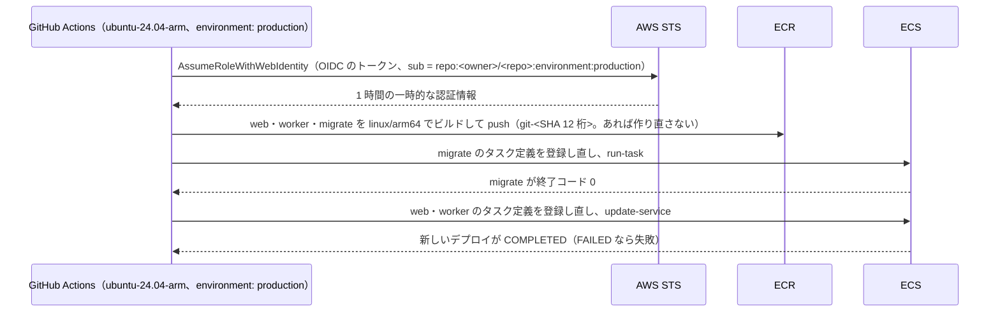

# CI/CD（GitHub Actions）

確認日：2026-11-25（第17章）。**この章ではワークフローを作るだけで、GitHub 上では実行していない。本物の AWS にも接続していない**（構文は actionlint、AWS の部分は Terraform のモックのテストと、aws CLI を差し替えた単体テストで確かめた）。テストの分担は `docs/testing.md`、本番の構成は `docs/architecture.md`、マイグレーションの手順は `docs/migrations.md` を正とする。

## 1. ワークフロー

| ファイル | いつ | 何をする | GITHUB_TOKEN の権限 | 秘密 |
|----------|------|----------|---------------------|------|
| `.github/workflows/ci.yml` | PR・main への push・週 1 回（security だけ）・手動 | 下の 7 つのジョブ | `contents: read` | 使わない |
| `.github/workflows/deploy.yml` | main への push の CI が成功したとき（`workflow_run`）・手動（main だけ） | ECR に push → migrate → web・worker | `contents: read`・`id-token: write`（OIDC） | 使わない（AWS は OIDC。値は environment の変数） |
| `.github/workflows/claude-review.yml` | PR（同じリポジトリのブランチから、下書きでないもの） | Claude Code によるセキュリティレビュー | `contents: read`・`pull-requests: write` | `ANTHROPIC_API_KEY` |

### ci.yml のジョブ

| ジョブ | 内容 | 必要なもの |
|--------|------|-----------|
| check | `npm ci` → `npm run check`（型・Lint・整形・単体・秘密情報・マイグレーションの危険な操作） | なし |
| build | `env -u DATABASE_URL -u BETTER_AUTH_SECRET npm run build`（環境変数なしでビルドできる。第8章の回帰） | なし |
| test-db | `npm run test:db` | サービスコンテナ `postgres:18.7`。`TEST_DATABASE_URL` |
| e2e | `npx playwright install --with-deps chromium` → `npm run test:e2e`。失敗したら `playwright-report/`・`test-results/` を 7 日残す | `postgres:18.7`・`rustfs/rustfs:1.0.6`。`E2E_DATABASE_URL`・`S3_ENDPOINT` とローカル用の鍵 |
| terraform | `terraform fmt -check -recursive`、`envs/prod` と `bootstrap` の `init -backend=false -lockfile=readonly`・`validate`・`test` | Terraform 1.17.2（Registry からプロバイダーを取るだけ。AWS には接続しない） |
| migrations | `npm run migrations:check -- --base <PR のベース、push の前のコミット>`（適用済みのマイグレーションの変更・削除も止める） | 全履歴（`fetch-depth: 0`） |
| security | `npm run audit:check`・`npm run secrets:scan -- --history` | レジストリへの接続、全履歴 |

### 共通の決まり

- **アクションはコミットの SHA で固定する**（タグは付け替えられる）。`uses:` の行の末尾のコメントに版を書く。版は `docs/tech-stack.md`。更新するときは、公開のリポジトリのタグ（`git ls-remote --tags`）から SHA を引き、`action.yml` の入力の変更を読む
- 権限は、ワークフローの先頭で `permissions: {}` または `contents: read` にし、要るジョブだけに足す
- `actions/checkout` は `persist-credentials: false`（後のステップに書き込みのトークンを残さない）
- `ci.yml` は秘密を使わないので、フォークからの PR でも同じように動く。`pull_request_target` はどのワークフローでも使わない
- ワークフローの構文の確認：`docker run --rm -v "$PWD:/repo" -w /repo rhysd/actionlint:1.7.12`（shellcheck・pyflakes を含むイメージ。`run:` のシェルも調べる）

## 2. デプロイ（deploy.yml）



1. **CI が通ったコミットだけ**をデプロイする。`workflow_run` は `ci.yml` が main への push で成功したときに動き、そのコミット（`head_sha`）を checkout する。手動（`workflow_dispatch`）は main からだけ
2. **長期のアクセスキーを使わない。** `aws-actions/configure-aws-credentials` が GitHub の OIDC のトークンで IAM ロールを引き受ける（`id-token: write`）。ロールは `infra/terraform/modules/deploy`
3. ARM64 のランナー（`ubuntu-24.04-arm`。AWS CLI・Docker Buildx・Node.js が入っている）で、Fargate（Graviton）と同じアーキテクチャのイメージを QEMU なしでビルドする。キャッシュは GitHub Actions のキャッシュ（`type=gha`）
4. ECR のタグは上書きできない（IMMUTABLE）。再実行したときは、push 済みのイメージを作り直さない
5. `node scripts/deploy/ecs-deploy.mts`（Node 24 の型の除去でそのまま動く。依存を足さず aws CLI を呼ぶ）：
   - 各タスク定義の最新の版を読み、**イメージのタグだけ**を差し替えて登録し直す（環境変数・シークレットの ARN・ロールは Terraform が決めたまま）
   - migrate を run-task し、終了コード 0 を確かめる。**失敗したら web・worker は更新しない**
   - web・worker を更新し、新しいデプロイの `rolloutState` が `COMPLETED` になるまで待つ。サーキットブレーカーが前の版に戻したら（`FAILED`）失敗にする。`aws ecs wait services-stable` は戻した後も「安定」になりうるので使わない（本物の AWS では未確認）
   - テスト：`scripts/deploy/ecs-deploy.test.ts`（aws CLI の偽物で、呼ぶ順番・migrate の失敗で止まること・戻されたら失敗すること・不正なタグを拒否すること・タスク定義の読み取り専用の項目を落とすこと。終了コードの確認を一時的に外すと「migrate が失敗したら…」が失敗することを確かめた）
6. `concurrency` で 1 つずつ実行し、途中で取り消さない（migrate とサービスの更新がずれないように）

**Terraform との分担**：ECS のサービスは `ignore_changes = [task_definition]`。デプロイが登録した版を、Terraform の apply が `var.image_tag` の版に戻さない。Terraform で環境変数などを変えると新しいタスク定義の版ができ、次のデプロイ（手動の再実行でもよい）がそれをもとにタグを差し替えて反映する。`image_tag` は初回の apply でだけ意味を持つ。

**ロールバック**：前のコミットのイメージは ECR に 30 個まで残る。前のコミットで `workflow_dispatch` を使うことはできない（main の先頭をデプロイする）ので、main で revert のコミットを作って CI を通す。マイグレーションは戻さない（expand と contract で、前の版も動くスキーマにしておく。`docs/migrations.md`）。

### デプロイのロールの権限（`modules/deploy`）

**信頼ポリシー**（`terraform test` の `deploy_role_trusts_only_this_repository_and_environment` で確かめる）：

```json
{
  "Effect": "Allow",
  "Principal": { "Federated": "arn:aws:iam::<account>:oidc-provider/token.actions.githubusercontent.com" },
  "Action": "sts:AssumeRoleWithWebIdentity",
  "Condition": {
    "StringEquals": {
      "token.actions.githubusercontent.com:aud": "sts.amazonaws.com",
      "token.actions.githubusercontent.com:sub": "repo:<owner>/<repo>:environment:production"
    }
  }
}
```

- `sub` は完全一致（`StringEquals`）。`StringLike` とワイルドカードは使わない。`github_repository`・`github_environment` は `*` を含むと検証で失敗する
- environment を使うジョブのトークンの `sub` にはブランチが入らない。**main に絞るのは GitHub の environment の設定**（§3）。ほかのブランチのジョブが `environment: production` を名乗っても、GitHub がジョブを始めない
- テストが空振りしていないことは、`sub` を `StringLike` の `repo:<repo>:*` にする・`aud` を外す・PassRole の条件を外す・RunTask を `*` にする、の 4 通りに一時的に壊して確かめた（どれも該当の run が失敗した）

**権限**：ECR のログイン（`GetAuthorizationToken`。リソースを指定できない）、3 つのリポジトリへの push、タスク定義の読み取りと登録（`DescribeTaskDefinition`・`RegisterTaskDefinition`。リソースを指定できない）、このクラスターでの migrate の `RunTask` と `DescribeTasks`、web・worker の `UpdateService`・`DescribeServices`、タスク定義のロールの `iam:PassRole`（`iam:PassedToService = ecs-tasks.amazonaws.com` のときだけ）。**Terraform の state・Secrets Manager の値・IAM の変更の権限はない**（デプロイは Terraform を実行しない）。

## 3. GitHub の設定（人が行う。この章では行っていない）

| 場所 | 設定 |
|------|------|
| Settings → Environments → `production` | Deployment branches and tags：**Selected branches → `main` だけ**。必要なら Required reviewers（承認してからデプロイ） |
| `production` の Variables | `terraform output github_deploy_variables` の値（`AWS_REGION`・`AWS_DEPLOY_ROLE_ARN`・`ECS_CLUSTER`・`NAME_PREFIX`・`ECR_REPOSITORY_PREFIX`・`MIGRATE_SUBNETS`・`MIGRATE_SECURITY_GROUPS`）。秘密ではないので Secrets にしない |
| Settings → Secrets and variables → Actions → Secrets | `ANTHROPIC_API_KEY`（Claude のレビューだけが使う。Environment ではなくリポジトリの Secret） |
| Settings → Branches（ルールセット） | main への直接の push を禁止し、PR で `ci.yml` の 7 つのジョブを必須にする。force push を禁止 |
| Settings → Actions → General | Fork pull request workflows：外部の協力者の初回は承認を必須にする。Workflow permissions：Read repository contents（既定を読み取りだけにする） |

## 4. 初回の手順（人が、管理者の端末から行う。この章では行っていない）

1. **state 用のバケット**：`cd infra/terraform/bootstrap && cp bootstrap.tfvars.example bootstrap.tfvars`（値を入れる）→ `terraform init && terraform apply -var-file=bootstrap.tfvars`
2. **backend**：`cd ../envs/prod && cp backend.hcl.example backend.hcl`（`bucket` を 1 の出力に）→ `terraform init -backend-config=backend.hcl`
3. **証明書と DNS**：ACM で `domain_name` の証明書を ap-northeast-1（ALB）と us-east-1（CloudFront）に発行し、DNS で検証する。`terraform.tfvars` に ARN を書く
4. **ECR とデプロイのロールを先に作る**：`terraform apply -target=module.ecs.aws_ecr_repository.this -target=module.deploy`（サービスはイメージがないと起動できないため）。GitHub の environment の変数（§3）を入れ、`deploy.yml` の migrate より前（push まで）が通ることを確かめる。または同じ Dockerfile で手元からビルドして push し、`image_tag` にそのタグを書く
5. **全体の apply**：`terraform plan` で CloudFront のマネージドポリシーの ID の照合（`modules/cdn` の precondition）と、RDS で使える PostgreSQL 18 のマイナーバージョンを確かめてから `terraform apply`
6. **人が入れるシークレット**：`flowdesk/prod/stripe`・`flowdesk/prod/smtp`（`docs/architecture.md` の 4）。SES のドメインの検証・DKIM・サンドボックスの解除
7. **DNS**：`domain_name` を `cloudfront_domain_name` に向ける
8. **デプロイ**：`deploy.yml` を手動で実行する。以後は main への push の CI の成功で動く
9. アラームのメール（`alarm_emails`）の購読の確認のリンクを押す

## 5. Claude Code のレビュー（claude-review.yml）

- `anthropics/claude-code-action`（v1.0.290、SHA で固定）。観点は `.claude/agents/security-reviewer.md` と同じ（認可・`organizationId`・他の組織は 404・Zod・秘密と個人情報の出力）。モデルもエージェントの定義（`model: sonnet`）に合わせて `claude-sonnet-5-5`
- API キーは GitHub の Secrets の `ANTHROPIC_API_KEY` から渡す（`secrets.ANTHROPIC_API_KEY`）。リポジトリにもワークフローにも値を書かない
- **フォークの PR では動かさない**：ジョブの `if` で `head.repo.full_name == github.repository` に限り、アクションの `allow_fork_prs` も `"false"`（既定）。`pull_request` のフォークの PR には GitHub がそもそも秘密を渡さないが、ジョブを始めないことで、失敗のログも残さない。Dependabot の PR も飛ばす
- 権限：`contents: read`・`pull-requests: write`（コメントだけ）。Claude のツールは `Read`・`Grep`・`Glob`・`git diff`/`log`/`show`・`gh pr diff`/`view`/`comment`・インラインのコメントだけで、`Edit`・`Write`・Web は禁止
- アクションは PR のとき `.claude/`・`CLAUDE.md`・`AGENTS.md` を**ベースのブランチから戻してから**動く（アクションの `docs/security.md`）。PR で `security-reviewer.md` やフック（`.claude/settings.json`）を書き換えても、そのレビューには効かない
- PR の本文・コメント・差分はデータとして扱い、指示として従わないようプロンプトに書いた（プロンプトインジェクションの対策の一部。完全ではないので、ツールと権限を絞ることを主にする）
- 指摘はそのまま直さない。第14章と同じく、コードを読んで確かめてから対応する（`docs/security.md` の 1）
