# ER 図

認証・組織まわり（`user`〜`invitation`）は Better Auth と organization プラグインが定義するテーブルで、`npx auth@1.7.27 generate --config src/server/auth-cli.ts` で Prisma スキーマに出力する（旧 `@better-auth/cli` は非推奨）。図にない `verification`（メール確認などのトークン）も出力される。
業務テーブルはすべて `organizationId` を持ち、Service 層のクエリで必ず条件に含める（N-01）。
予約・添付ファイルから店舗・スタッフ・顧客・メニューへの参照は `(organizationId, xxxId)` → `(organizationId, id)` の複合外部キーにしてあり、他の組織の行を参照する INSERT・UPDATE は DB が拒否する。
日時の列は `timestamptz` で、UTC として保存する。

```mermaid
erDiagram
    user ||--o{ session : has
    user ||--o{ account : has
    user ||--o{ member : "belongs via"
    organization ||--o{ member : has
    organization ||--o{ invitation : has
    organization ||--o{ location : has
    organization ||--o{ service : has
    organization ||--o{ customer : has
    organization ||--o{ reservation : has
    organization ||--o| subscription : has
    organization ||--o{ auditLog : has
    member ||--o| staffProfile : "is staff"
    location ||--o{ reservation : at
    staffProfile ||--o{ reservation : handles
    customer ||--o{ reservation : books
    service ||--o{ reservation : for
    customer ||--o{ attachment : has
    organization ||--o{ customerExport : has
    organization ||--o{ job : has
    organization ||--o{ stripeEvent : "receives"

    organization {
        string id PK
        string name
        string slug UK
    }
    member {
        string id PK
        string organizationId FK
        string userId FK
        string role "owner | admin | staff"
    }
    staffProfile {
        string id PK
        string organizationId FK
        string memberId FK,UK "メンバー削除で null"
        string displayName
        boolean active
    }
    location {
        string id PK
        string organizationId FK
        string name
        string timezone "Asia/Tokyo"
    }
    service {
        string id PK
        string organizationId FK
        string name
        int durationMinutes
        int priceYen
    }
    customer {
        string id PK
        string organizationId FK
        string name
        string nameKana
        string email
        string phone
        string note
        datetime deletedAt "論理削除"
    }
    reservation {
        string id PK
        string organizationId FK
        string locationId FK
        string staffProfileId FK
        string customerId FK
        string serviceId FK
        datetime startsAt
        datetime endsAt
        string status "pending | confirmed | cancelled | done"
        int priceYen "予約時点の料金を保存"
        int version "楽観ロック"
    }
    attachment {
        string id PK
        string organizationId FK
        string customerId FK
        string s3Key "サーバーが決める"
        string fileName
        string contentType
        int sizeBytes
        string status "pending | uploaded"
        string uploadedByUserId
        datetime createdAt
    }
    customerExport {
        string id PK
        string organizationId FK
        string requestedByUserId
        string status "pending | done | failed"
        string s3Key
        int rowCount
        datetime createdAt
        datetime completedAt
    }
    job {
        string id PK
        string organizationId FK "組織に属さないメールは null"
        string type "mail.send など"
        json payload
        string idempotencyKey UK
        string status "queued | running | succeeded | failed"
        int attempts
        datetime lockedUntil
        datetime publishedAt
    }
    subscription {
        string id PK
        string organizationId FK,UK
        string stripeCustomerId UK
        string stripeSubscriptionId UK
        string plan "free | pro"
        string status "none（申し込み前）| Stripe の status"
        datetime currentPeriodEnd
        boolean cancelAtPeriodEnd
        string stripePriceId
        datetime lastEventAt "反映した最後の event.created"
    }
    stripeEvent {
        string id PK "Stripe のイベント ID"
        string type
        string organizationId "組織が分からなければ null"
        string result "applied | stale | ignored"
        datetime createdAt "event.created"
        datetime receivedAt
    }
    auditLog {
        string id PK
        string organizationId FK
        string actorUserId
        string action "customer.update など"
        string targetType
        string targetId
        json diff
        datetime createdAt
    }
```



メンバーを削除しても `staffProfile` は消さない（担当した予約の履歴が `(organizationId, staffProfileId)` で参照しているため）。`memberId` は `ON DELETE SET NULL` で null になり、`active` を false にする（第10章、マイグレーション `20261124123959_staff_profile_keep_on_member_removal`）。

## 非同期ジョブ（第11章、マイグレーション `20261124150000_uploads_exports_jobs`）

- `job` は SQS に送るジョブの中身（Transactional Outbox）。業務の変更（予約の確定・招待・エクスポートの依頼）と同じトランザクションで作り、コミットした後に `{ jobId }` だけを SQS に送る。送れなかったものは Worker が 1 分ごとに拾って送り直す
- `idempotencyKey` の一意制約で、同じ依頼は 1 件にまとまる（例：`reservation.confirmed:{予約ID}:{開始日時}`）。Worker は条件付きの UPDATE で `queued` を `running` にしてから処理するので、同じメッセージが 2 回届いても処理は 1 回
- 3 回失敗すると `failed` になり、メッセージは DLQ に移る（`docker/elasticmq.conf`）
- `job` は Worker がすべての組織について処理するため ID で引く。組織のデータは payload の `organizationId` で絞り込んで読む
- 送ったメールの本文（パスワード再設定のリンクなど）は、送信後に `payload` から消す

## 料金プラン（第12章、マイグレーション `20261124174511_billing`）

設計は `docs/billing.md`。

- `subscription` は組織ごとに 1 行（課金の単位は組織）。行がない組織は Free。`plan` は Webhook でだけ書き換える
- `stripeEvent` は受け取った Stripe のイベントの記録（Webhook の冪等性）。イベント ID が主キーで、反映と同じトランザクションで作る
- Webhook は組織の文脈を持たずに届くので、`subscription` を Stripe の顧客 ID（`stripeCustomerId`、一意）で引く。顧客はサーバーが組織ごとに作るので、顧客 ID が組織を決める（`job` を ID で引くのと同じ例外。`src/server/repositories/subscriptions.ts`）
- `stripeEvent.organizationId` には外部キーを付けない（組織を削除しても、受け取ったイベントの記録は残す）

## テナント分離の方式（第10章）

マルチテナントのデータの分け方は、大きく 3 つある。

| 方式 | 仕組み | 分離の強さ | 運用・コスト | 向いている場面 |
|------|--------|-----------|-------------|----------------|
| アプリでの絞り込み（共有スキーマ） | 全テナントが同じテーブルを使い、すべてのクエリに `WHERE organizationId = ?` を付ける | 絞り込みを 1 か所でも忘れると他のテナントのデータが見える。コードレビューとテストで守る | テーブルもマイグレーションも 1 組。テナントの追加は行の INSERT だけ。集計・横断の検索が簡単 | 小〜中規模のテナントが多数ある SaaS |
| PostgreSQL の Row Level Security（共有スキーマ＋RLS） | テーブルに `POLICY ... USING ("organizationId" = current_setting('app.org_id'))` を付け、接続（トランザクション）ごとに `SET LOCAL app.org_id` する | 絞り込みを忘れても DB が行を返さない。ただし設定し忘れ・スーパーユーザーや `BYPASSRLS` のロール・`SET LOCAL` を外れた接続プールの再利用で効かなくなる | ポリシーの管理とテストが増える。Prisma はトランザクションごとに `set_config` を呼ぶ拡張（`$extends`）が必要で、`$transaction` をまたぐ処理や接続プール（PgBouncer のトランザクションモード）との組み合わせに注意がいる。マイグレーション（Prisma Migrate）はポリシーを表現できず SQL を手で書く | 規制が厳しい、多層防御を DB でも持ちたい |
| スキーマ／DB の分割 | テナントごとに PostgreSQL のスキーマ、または DB（インスタンス）を分ける | 最も強い。誤ったクエリでも他のテナントの行に届かない（接続先・`search_path` を誤らない限り） | テナント数だけマイグレーションを当てる必要があり、失敗したテナントだけ古い版になる。接続数・バックアップ・監視がテナント数に比例する。横断の集計が難しい | テナント数が少なく 1 社が大きい、契約でデータの物理的な分離を求められる |

**FlowDesk はアプリでの絞り込み（共有スキーマ）を採用する。** 理由：

1. 想定する顧客は小規模な店舗が多数（1 組織あたり数人〜十数人のスタッフ、Free プランあり）。テナントごとのスキーマ・DB は、テナント数に比例するマイグレーションと接続の運用に見合わない
2. 認証・組織まわりは Better Auth の organization プラグインが共有スキーマ（`member.organizationId`）を前提にしている
3. Prisma 7 とドライバアダプター（`@prisma/adapter-pg`）の構成で RLS を使うには、すべてのクエリをトランザクションで包んで `set_config` する必要があり、第9章の楽観ロック・排他制約の処理と組み合わせると複雑になる。書籍の範囲では、効果に対して導入と検証のコストが大きい

絞り込み漏れの弱点は、次の層で補う：

- **規約**：業務テーブルはすべて `organizationId` を持ち、Repository の関数は第 1 引数に `organizationId` を取る。ID だけで取得するクエリを書かない（`CLAUDE.md`）。組織に属さない `user`・`invitation`（招待された本人が開く S-05）は、ログイン中の本人の ID・メールアドレスで絞り込む
- **DB の制約**：組織をまたぐ参照は `(organizationId, id)` の複合外部キーで DB が拒否する（上記）
- **入口**：`[org]` のスラッグから `getOrgContext` でメンバーであることを毎回確かめ、メンバーでなければ 404（存在を漏らさない）
- **テスト**：`docs/authz-matrix.md` のケース 1（他の組織の ID は 404）を Service と Route Handler の両方で確かめる（`*.db.test.ts`、第13・14章）

将来、規制や大口の顧客の要件で DB 側の防御が必要になったら、共有スキーマのまま RLS を追加できる（テーブルの形は変わらない）。

## スキーマでは表せない制約（マイグレーション SQL で追加）

Prisma のスキーマ言語は排他制約を表現できないため、`prisma migrate dev --create-only` で生成した SQL に追記する（第9章）。

> 検証済み（2026-11-23、`postgres:18` イメージ＝PostgreSQL 18.7）：同じスタッフで時間が重なる INSERT と、キャンセル済みを `confirmed` に戻す UPDATE は排他制約違反で拒否された。終了時刻ちょうどに始まる予約（`tstzrange` は既定で `[)` の半開区間）、別スタッフの同時刻予約、キャンセル済みとの重複は登録できた。

```sql
CREATE EXTENSION IF NOT EXISTS btree_gist;

ALTER TABLE reservation
  ADD CONSTRAINT reservation_no_overlap
  EXCLUDE USING gist (
    "staffProfileId" WITH =,
    tstzrange("startsAt", "endsAt") WITH &&
  )
  WHERE (status <> 'cancelled');
```

アプリ側の「重複チェックしてから INSERT」だけでは、同時リクエストで二重予約が起きる。DB 制約で最終的に防ぎ、アプリは制約違反を「その時間は埋まっています」に変換する。AI に実装させるとアプリ側チェックだけになりやすい箇所なので、第9章の「AI 生成コードの問題と改善例」で扱う。

## インデックス方針（第15章で計測して確定）

- 業務テーブルは `(organizationId, ...)` の複合インデックスを基本にする
- `reservation (organizationId, startsAt)`：カレンダーとダッシュボード
- `customer (organizationId, nameKana)`：一覧と検索
