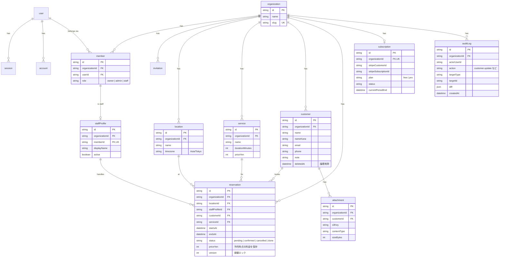

# ER 図

認証・組織まわり（`user`〜`invitation`）は Better Auth と organization プラグインが定義するテーブルで、`npx auth@1.7.27 generate --config src/server/auth.ts` で Prisma スキーマに出力する（旧 `@better-auth/cli` は非推奨）。図にない `verification`（メール確認などのトークン）も出力される。
業務テーブルはすべて `organizationId` を持ち、Service 層のクエリで必ず条件に含める（N-01）。
予約・添付ファイルから店舗・スタッフ・顧客・メニューへの参照は `(organizationId, xxxId)` → `(organizationId, id)` の複合外部キーにしてあり、他の組織の行を参照する INSERT・UPDATE は DB が拒否する。
日時の列は `timestamptz` で、UTC として保存する。



## スキーマでは表せない制約（マイグレーション SQL で追加）

Prisma のスキーマ言語は排他制約を表現できないため、`prisma migrate dev --create-only` で生成した SQL に追記する（第9章）。

> 検証済み（2026-11-23、`postgres:18` イメージ＝PostgreSQL 18.7）：同じスタッフで時間が重なる INSERT と、キャンセル済みを `confirmed` に戻す UPDATE は排他制約違反で拒否された。終了時刻ちょうどに始まる予約（`tstzrange` は既定で `[)` の半開区間）、別スタッフの同時刻予約、キャンセル済みとの重複は登録できた。

```sql
CREATE EXTENSION IF NOT EXISTS btree_gist;

ALTER TABLE reservation
  ADD CONSTRAINT reservation_no_overlap
  EXCLUDE USING gist (
    "staffProfileId" WITH =,
    tstzrange("startsAt", "endsAt") WITH &&
  )
  WHERE (status <> 'cancelled');
```

アプリ側の「重複チェックしてから INSERT」だけでは、同時リクエストで二重予約が起きる。DB 制約で最終的に防ぎ、アプリは制約違反を「その時間は埋まっています」に変換する。AI に実装させるとアプリ側チェックだけになりやすい箇所なので、第9章の「AI 生成コードの問題と改善例」で扱う。

## インデックス方針（第15章で計測して確定）

- 業務テーブルは `(organizationId, ...)` の複合インデックスを基本にする
- `reservation (organizationId, startsAt)`：カレンダーとダッシュボード
- `customer (organizationId, nameKana)`：一覧と検索
